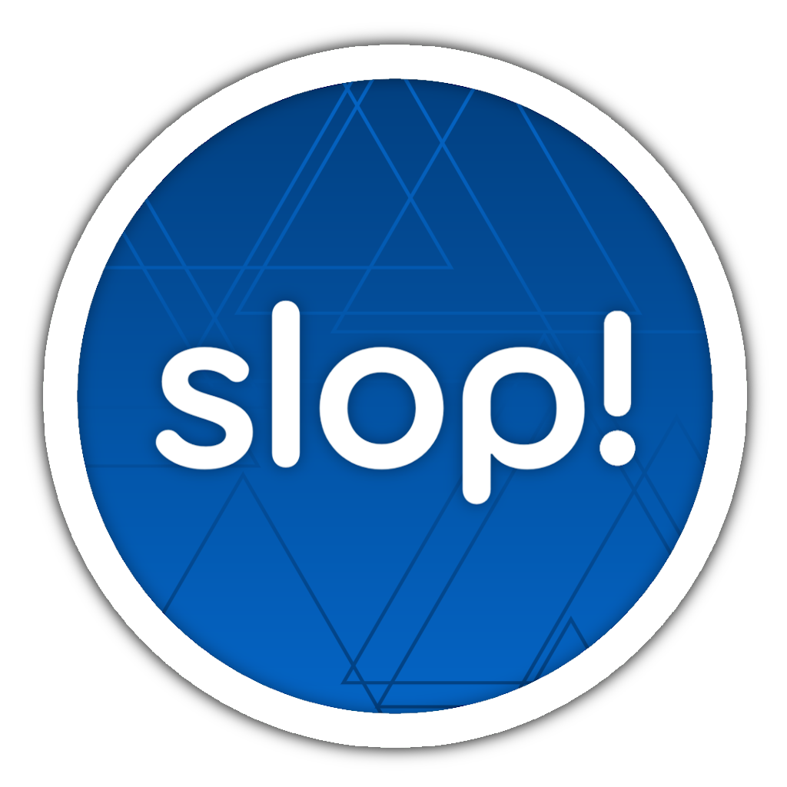

<p align="center">
  
</p>

# slop!

A vibe-coded mapping(?) client. slop is just a *click* away!

This is an independant fork of [osu!lazer](https://github.com/ppy/osu) i made for myself which primarily focuses on the editor which implements some stable stuff + other features with the help of Claude Opus 5.5 (i'm not proud of it either ok). 

I do *try* to keep up with upstream (basically telling claude to merge) to get the latest updates.

This is not an AI map generator; it's just a lazer fork with extra features and some fixes.

## License

**slop!** is a fork of [osu!](https://github.com/ppy/osu) and uses a
[fork of osu-framework](https://github.com/wuaht/osu-framework).
The source code is licensed under the [MIT License](https://opensource.org/licenses/MIT).
See the [LICENCE](https://github.com/wuaht/osu/blob/slop/LICENCE) file for details.

This project is not affiliated with or endorsed by ppy Pty Ltd, and it is non-commercial.

The "osu!" and "ppy" names and branding are protected by trademark law
and are **not** covered by the MIT License.

The [game's resources](https://github.com/wuaht/osu-resources) are forked from
[ppy/osu-resources](https://github.com/ppy/osu-resources) and are covered by a separate license:
[CC BY-NC 4.0](https://creativecommons.org/licenses/by-nc/4.0/).

## Online functionality
Since this is **not** an official client scores will not submit. (only few online features work)

It is possible to create a (or multiple) local offline accounts to track your scores if you would rather stay off of Bancho completely.

The client also has beatmap mirror support (only Mino tested), so you don't even have to login to download maps

## Features
full list of features not available yet since i still have stuff i want to implement.

But there is *osu!fps* (first person osu!) and a *new* editor look with a hitsound editor and a BN manager. And also frosted sliders and hit circles.

## Building/Installing

Building this client requires local osu-framework and osu-resources checkouts:** clone [wuaht/osu-framework](https://github.com/wuaht/osu-framework) and [wuaht/osu-resources](https://github.com/wuaht/osu-resources) (both on branch `slop`) next to this repository (`../osu-framework` and `../osu-resources`), as it references them directly instead of the NuGet packages (needed for features like frosted sliders and custom assets).
Btw for a proper environment check out the [original readme](https://github.com/ppy/osu/blob/master/README.md#developing-osu) on how to set it up.

osu!fps lives in its own repository ([wuaht/osu-fps](https://github.com/wuaht/osu-fps), where it can also be downloaded as a ruleset for osu!lazer) and is included as the `osu-fps` submodule, so clone with `--recurse-submodules` (or run `git submodule update --init` afterwards).

```shell
git clone -b slop https://github.com/wuaht/osu-framework ../osu-framework
git clone -b slop https://github.com/wuaht/osu-resources ../osu-resources
```

Install the client with `slop-win-Setup.exe` from the [latest release](https://github.com/wuaht/osu/releases/latest); it updates itself from these releases and installs independently of osu!(lazer). <- hopefully

On Linux, use `slop.AppImage` from the same release (it also updates itself). For macOS there are untested, unsigned portable builds (`slop-osx-arm64-portable.zip` for Apple Silicon, `slop-osx-x64-portable.zip` for Intel) without auto-updates; after extracting, run `xattr -cr slop` once, then start `slop/osu!`. Releases are built with `release-build.ps1` (`-Platforms win,linux,osx`).

## Contributing

Not accepting contributions unless you know what I'm building (this is a personal fork after all).

If you didn't already notice by now everything i added (except for logo) was made using Claude Opus 5.5, which is why *slop!* is an independant fork and is not intended to be merged into
upstream ([they don't accept AI](https://github.com/ppy/osu/blob/master/README.md#contributing)).
