# Features
This will be a big list of features that I added to this client with more coming or missing.

## Editor
- **Hitsound Editor**: an Editor dedicated to make your maps rankable with hits and sounds.
  - **Lanes**: There is a lane for each sample and sublanes for custom samples as well (you can drag + drop on the lane to add)
  - **Patterns**: Just like FL Studio, you can create hitsound patterns. 
    - Changes you make in the pattern will apply to other instances of the pattern
    - You can make them unique with right-click on the pattern if you want small changes
    - You can also make a pattern out of subpatterns by creating a pattern with a pattern fully enclosed inside it.
    - Change color of the pattern or drag them around
  - Solo lanes, mute effects/music
  - Automatically syncs your hs diff to other diffs in the set (toggle in settings, default on)
  - Also applies hitsounds _while you map_, if you already have a HS diff.
  - Shows hitsound inconsistencies with other maps
  - 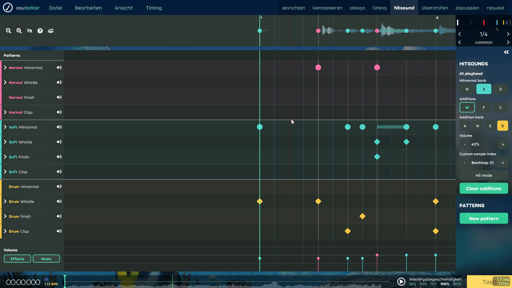
- **New translucent Editor look**
  - with an option to have a frosted-style toolbox
  - and change accent color
  - 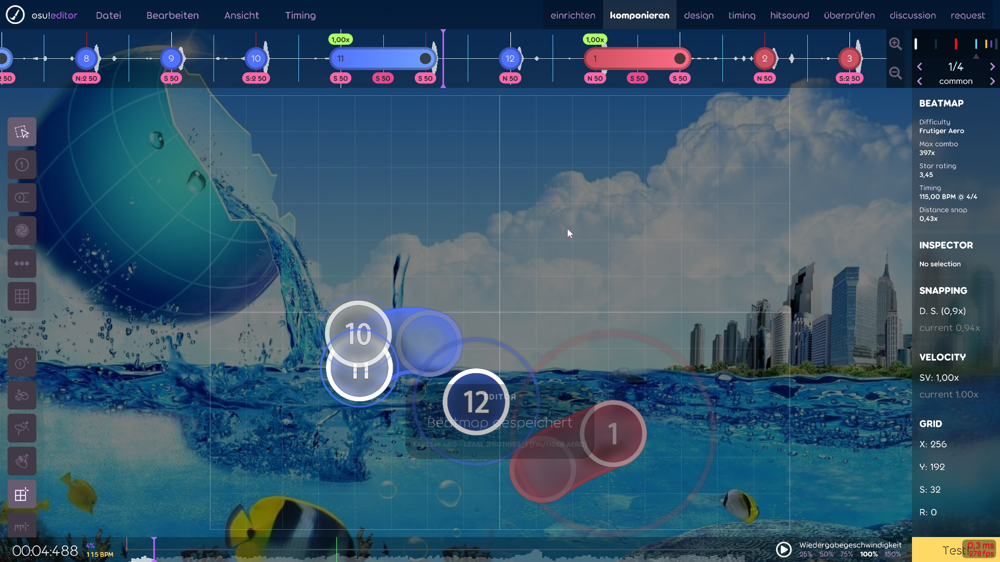 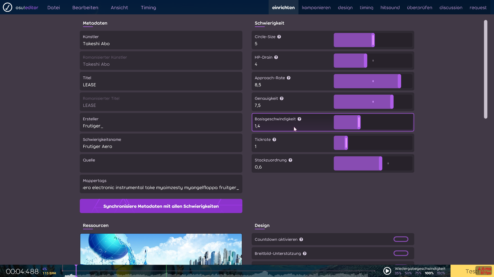
- **Mapset Verifier**: ported straight to the "verify"-Tab with a Lazer-style look with docs and images and overview
  - 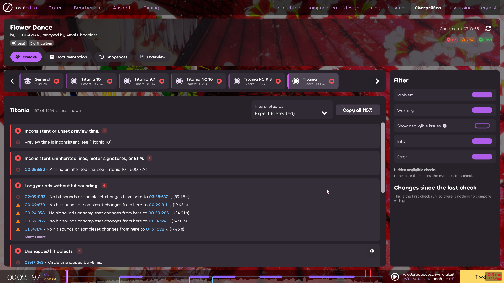
- **Request tab**: BN Request type tracker, that will track which BNs you've already asked, rejected you, maybe'd you, accepted you etc.
  - Runs on my online site currently not available to the public rn :/
  - fun lil animation playing when you get an accept
  - 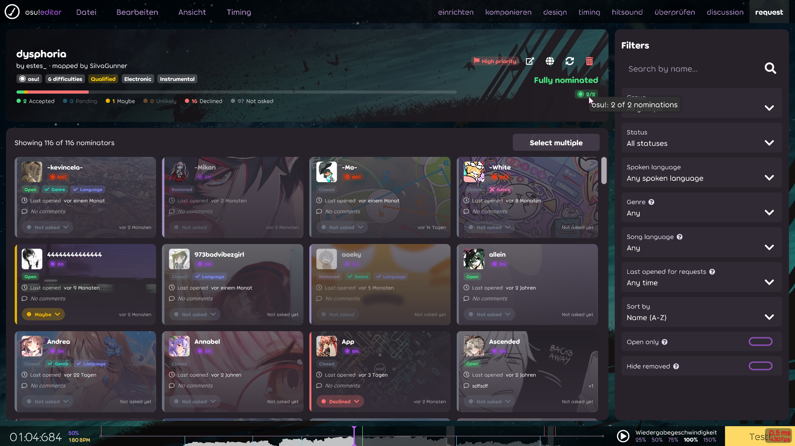
- **Discussions tab**: all your mods in lazer now with the discussion tab, where all discussion takes place from the website
  - WILL require you to sign in a browser window which will open when you check a box when you sign into lazer.
  - 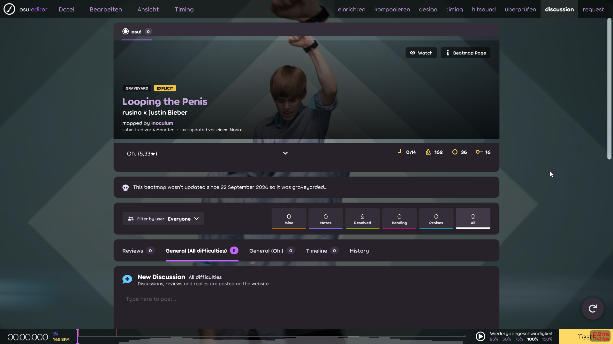
- **Editor Song Select**: Just like Stable, you can now browse through your maps and open them in the editor from the song select.
  - 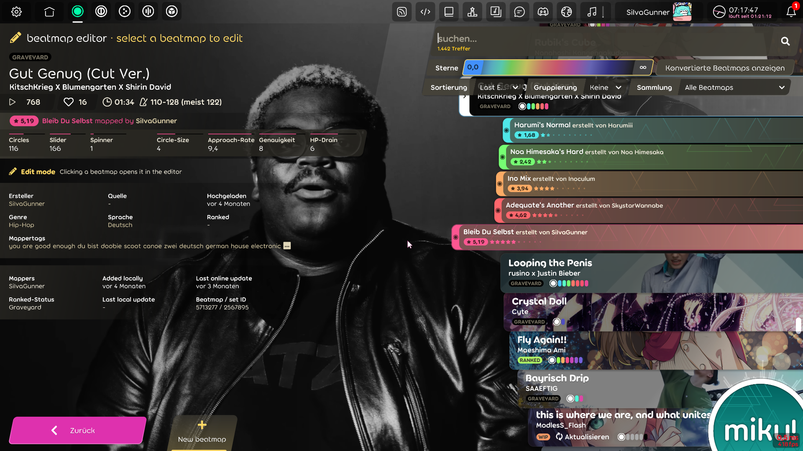
- **Timing Tools**: 
  - Timing detection from Timing Analyzer
  - Onset waveform which you can snap to
  - **Tempora** bar-by-bar view
  - removing redundant timing points (havent tested fully yet)
  - Timing sync across difficulties in the Timing menu at the top, ported from Mapping Tools
  - (expandable timing list and right panel btw)
  - 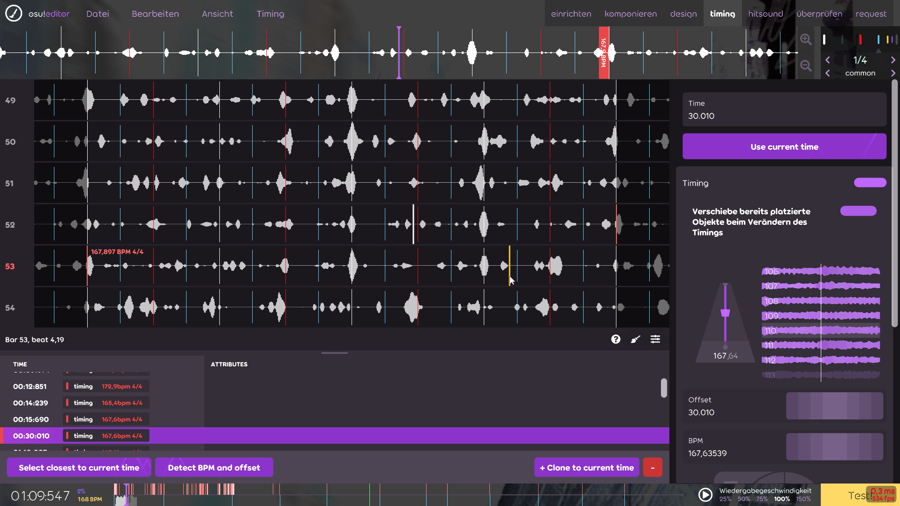
- **New stream object**:
  - Idea from [minetoblend](https://github.com/minetoblend/), a slider-like object that's actually a stream
  - Can modify it like a slider
  - Per section density, gradual density changes and acceleration
  - Stores in .osu so it can be editable anytime
  - 
- **Stream conversion popover**: new acceleration and wiggle, from [Khang](https://github.com/khang06)
  - 
- **Slider Generator**: Tool ported from [Slider Painter](https://osu.ppy.sh/community/forums/topics/1842546)
  - Generator Hotkey from [Khang](https://github.com/khang06), with an added feature of taking a random shape from a map you have downloaded (toggle in settings)
  - 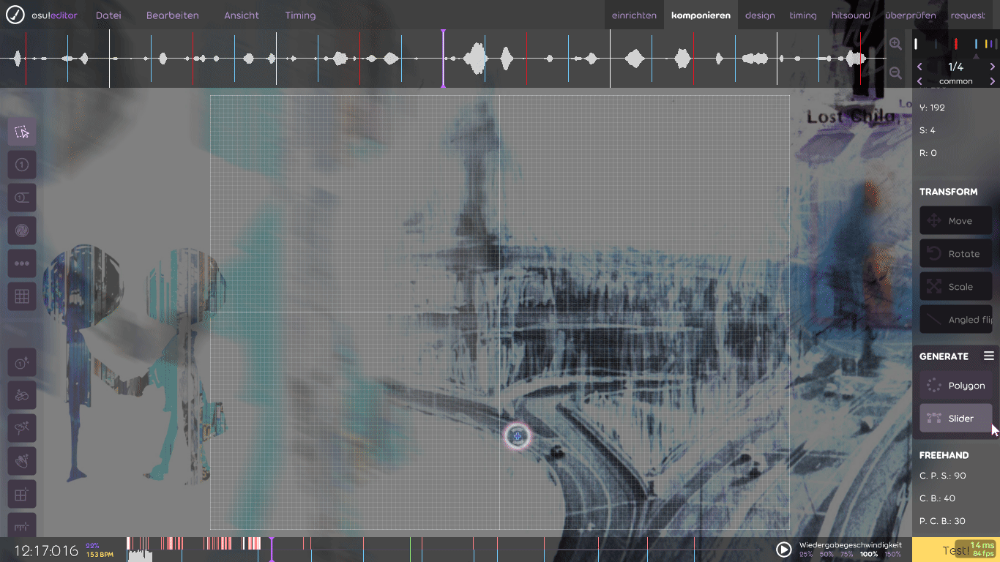
- Realistic auto cursor preview in the editor to look at flow, Idea from [minetoblend](https://github.com/minetoblend/)
    - 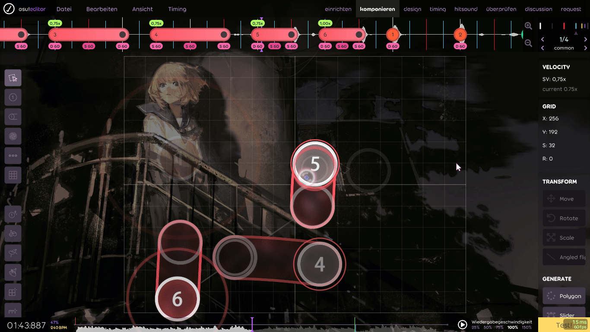
- Map cleaner (Timing Menu < Clean up map) ported from Mapping tools
- New Snappings!! Blankets, triangles, straight lines
    - 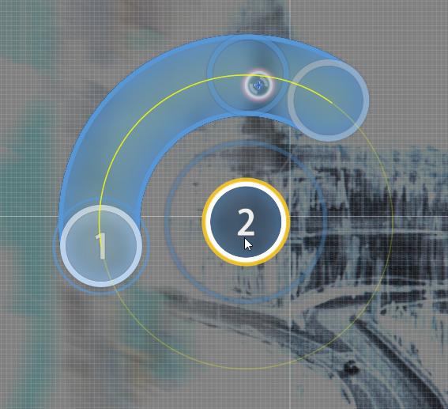
    - 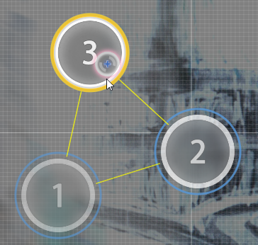
    - 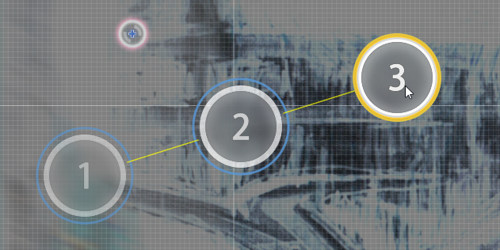
- More scaling options
- Split sliders with ctrl + right click
- Bend Bezier sliders with Middle Mouse button + drag
- mirror sliders (right click and mirror)
- Slider end snapping to timing points & later (minetoblend)
- Difficulty strain graph in the bottom timeline
- Waveform styles like Three-Band, FL Studio/MiniMeters, Onsets, Default, Lazer
- Unsnapped objects show on the timeline above with a broken link icon
- Offscreen object highlighting
- Backup when saving a map
- Autosave
- Drag & Drop to import .osu files
- Choose which difficulties to upload when submitting (hitsound diffs will automatically be deselected)
- Ctrl + Shift + C copies objects in .osu format instead of timestamp
- Ctrl + Shift + Rotate rotates by 5° default, + alt in 1°, can change values
- Custom rotate angle hotkey as well
- Test play with converted modes and Mods
- Loop music, 150% playback speed
- Other beatmap file actions
- **Lots of new keybinds** to rotate, flip, mute etc. etc.

## Gameplay
- **[osu!fps](https://github.com/wuaht/osu-fps)**: McOsu's FPoSu! but in Lazer 
  - 
- **Autoplay engines**: Miku (realistic auto), Auto+ and Pippi (Danser), with tag cursors and option to save auto replays
- Object visibility toggles like animations, kiai, cursor-expand
- Fail, flashlight, hitsound volume, HUD, dim and cursor trail options
- Mania: a waveform under the playfield (editor)
- Per-mode skins
- Skip Intro **and breaks**
- **Unlimited and custom FPS Limits**

## Visuals
- **Legacy Song Select**: Legacy Stable skins in Song Select (also unfinished legacy result screens from above)
  - 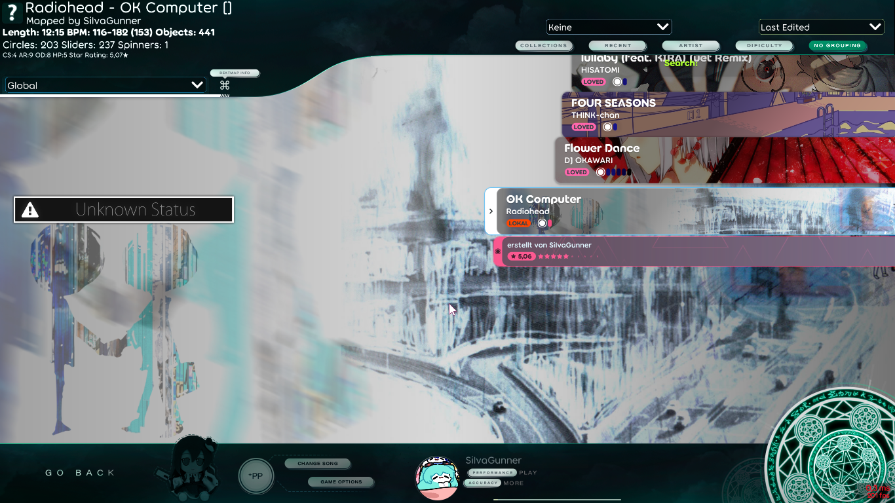
- **New Slider body types**: Frosted Glass (minetoblend) and Liquid Glass styles for slider bodies and hitcircles
  - 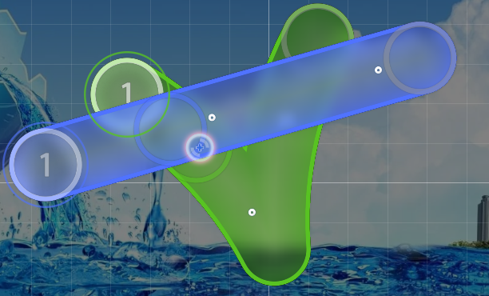
  - 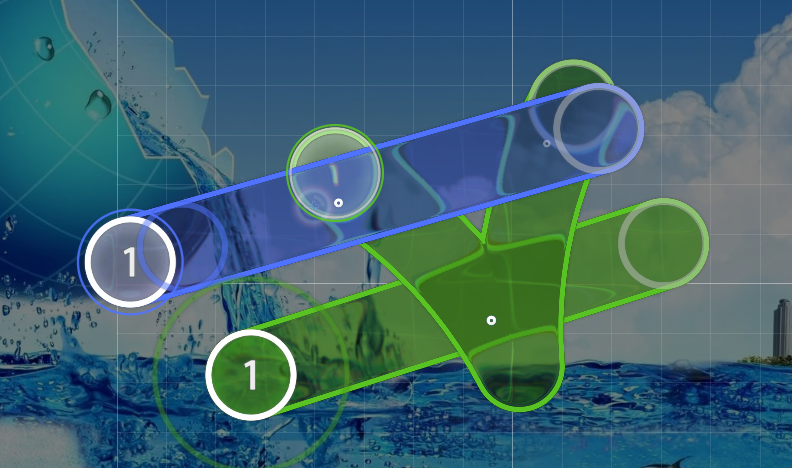
- Chroma color for cursor, cursor trail and combo colors
- Gradient Combo Colors
- Skin cursor or system cursor in menus
- **User pages and beatmap descriptions** render now
- Own changelog tab with stable and nightly changes

## Online
- **Built-In Discord Client**:
  - SDK version, stripped down, uses official discord sdk to receive and send dms (safe).
  - Full client **(might get u banned)** with servers, threads, forums, reactions, emojis gif sticker pickers, media viewer + player
    - - 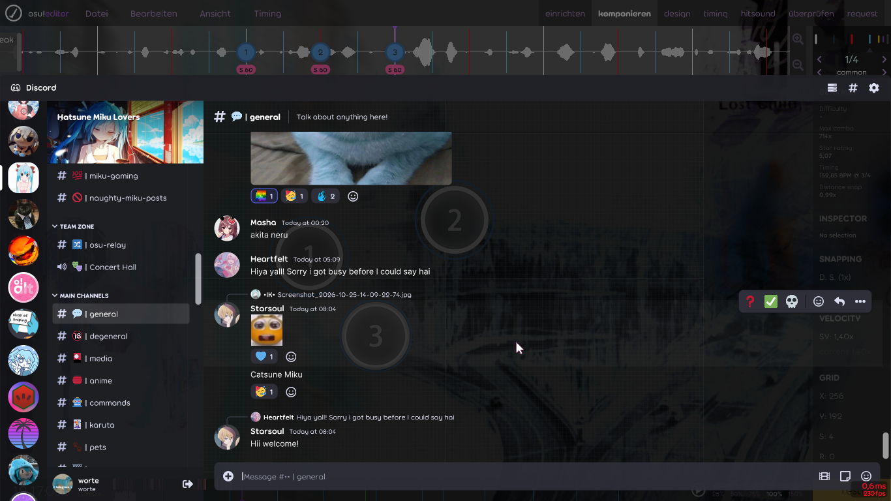
  - osu! editor timestamps are also clickable in the in-game discord client
    - 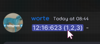
- **Offline Profiles** that tracks your scores locally, with stats for other rulesets
  - Can create multiple offline profiles with their own plays, profile picture, banner, flag
  - like mcosu
- Beatmap mirrors for downloading offline

## Client
- Settings, database and data location kept separate from official lazer, so both can be installed side by side
- Stable and nightly update channels; auto-updates can be turned off in settings
- miku..